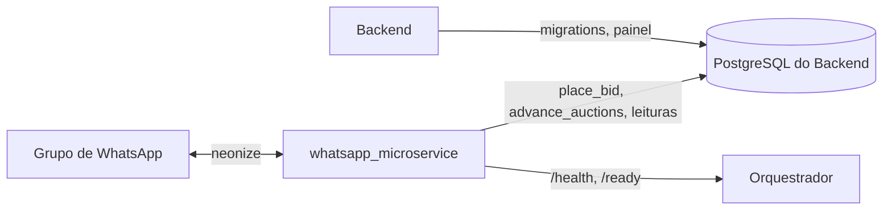

# Arquitetura

## Responsabilidade única

Conversar com o WhatsApp em nome de cada loja: ler lances no grupo, registrá-los pela função
`place_bid` do banco, postar a carta e anunciar o vencedor. **Não** implementa regra de lance, **não**
manda mensagem privada automática (ADR 0006), **não** adiciona participantes por API (maior gatilho
de ban) e **não** é dono do schema.

## O que ele consome

- Mensagens dos grupos de WhatsApp (um cliente neonize por loja).
- O relógio: a cada minuto, por loja, a agenda chama `advance_auctions`.
- O banco compartilhado (estado dos leilões e das lojas). Contrato em [`docs/integration.md`](docs/integration.md).

## O que ele produz

- Lances gravados (`place_bid`) e virada de estado dos leilões (`advance_auctions`).
- Mensagens no grupo: reação a cada lance, carta (imagem e legenda) ao abrir, vencedor marcado ao encerrar.
- `stores.whatsapp_status` e `whatsapp_group_id`.

## Comunicação com o resto do sistema

| Com quem | Mecanismo |
| --- | --- |
| PostgreSQL do Backend | SQL, papel próprio, RLS por `app.store_id` |
| WhatsApp | neonize (whatsmeow), sessão por QR Code |
| Backend (HTTP) | nenhuma chamada direta hoje; se for preciso, vira ADR |

Tabelas e funções acessadas: ver a lista em [`docs/integration.md`](docs/integration.md), que este
documento espelha.

## Diagrama de integração



## Estrutura do código

```text
src/pokemon_bot/
  parser.py        # "#A41 R$ 50,00" -> ParsedBid (contrato com o Backend)
  participant.py   # telefone, LID e fallback
  reactions.py     # outcome de place_bid -> reação no grupo
  templates.py     # textos configuráveis por loja
  db.py, repository.py   # contexto de loja (RLS) e chamadas às funções do banco
  trigger/         # tudo que aciona o bot
    health.py      # /health e /ready
    whatsapp/      # neonize atrás de ports.py: sessão por loja, reconexão, ritmo, QR, status
  config.py, logging_setup.py
```

O núcleo não importa neonize nem psycopg.

## Decisões relevantes

- Python com neonize (ADR 0015). O spike do dono (`docs/spike/`) é referência, não código de produção.
- Voto de enquete nativa chega como hash sha256 da opção e como a seleção completa atual: compare
  com o snapshot anterior. Só vale se a enquete nativa for adotada (pergunta aberta ao dono).
- JID sempre sem sufixo de dispositivo (`JIDToNonAD`). Em grupo o remetente pode ser LID: tentar
  `SenderAlt` e `get_pn_from_lid`; se não resolver, registrar o fato (sem o LID) e não dar lance.
- Nenhuma exceção escapa do callback do whatsmeow: todo handler fica em try/except.
- Envio com ritmo humano (atrasos aleatórios e limite por minuto, por loja) para reduzir risco de ban.
- Uma sessão por loja, com banco de sessão próprio (`SESSION_DB_TEMPLATE`). Só abre sozinha a loja
  que já tem sessão pareada; QR novo é pedido por `SessionManager.pair`. A sessão do neonize nunca
  passa pelo banco do Backend (D17, opção a). A API instalada (0.5.2) não tem o parâmetro `database=`
  que o README cita: usar Postgres para a sessão ainda precisa ser testado com a conta real.
- `LoggedOut` não reconecta sozinho; queda de rede reconecta com espera de 2 s a 5 min.
- **Mensagem editada não vira lance** (decisão do agente, reversível): a edição não desfaz um lance
  já registrado e deixaria reescrever o valor depois do fato. Quem quer mudar o lance manda outra
  mensagem. Texto antes ou depois de `#ID valor` também descarta a mensagem.
- **Telefone**: o bot usa o número do WhatsApp como veio (só dígitos, com país). Números brasileiros
  antigos sem o nono dígito podem divergir do cadastro do Backend (`normalizePhone`): risco a validar
  com conta real.
