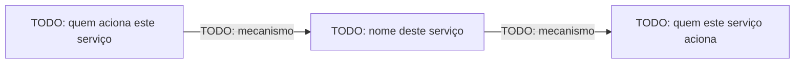

# Arquitetura

> Esqueleto a ser preenchido na entrevista do [`BOOTSTRAP.md`](BOOTSTRAP.md).
> Não copie a arquitetura de outro serviço para cá — este documento
> descreve apenas a fatia deste serviço. A visão do sistema inteiro, as
> decisões cross-repo e o glossário ficam no docs/shared do projeto:
> <!-- org/repo -->.

## Responsabilidade única

**TODO(bootstrap):** em uma frase, o que este serviço faz e, tão
importante quanto, o que ele **não** faz.

## O que ele consome

**TODO(bootstrap):** de onde vem o trabalho deste serviço (fila, evento,
requisição HTTP, cron) — referenciar [`docs/integration.md`](docs/integration.md)
para o contrato completo.

## O que ele produz

**TODO(bootstrap):** o efeito colateral/saída deste serviço (mensagem
publicada, resposta HTTP, escrita em banco, chamada a uma API externa).

## Comunicação com o resto do sistema

**TODO(bootstrap):** listar cada sistema/serviço com quem este serviço
troca dados, e o mecanismo usado (fila X, evento Y, HTTP para Z, banco
compartilhado W). Se houver banco compartilhado, a lista de
tabelas/schemas acessados deve espelhar a tabela em
[`docs/integration.md`](docs/integration.md).

## Diagrama de integração

> Mostra só a fatia de integração deste serviço — não o sistema inteiro.

## Decisões relevantes

**TODO(bootstrap/contínuo):** decisões de design que não são óbvias a
partir do código (trade-offs, restrições de infraestrutura, motivos de
uma escolha específica). Novas decisões relevantes devem ser
adicionadas aqui ao longo da vida do serviço, não só no bootstrap.
